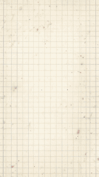

# Motion Studio: una skill de Claude que anima cada fotograma en código

**Sin modelos de vídeo con IA.** Claude dibuja cada fotograma en JavaScript sobre un canvas, lo renderiza con el Chrome que ya tienes instalado, corta las escenas sobre tu voz en off y le pone sonidos de papel que sintetiza él mismo. Obtienes un MP4 terminado, listo para publicar.

<p align="center"></p>
<p align="center"><sub>La demo de la plantilla: 100 % procedural. <a href="docs/demo.mp4">MP4 con sonido</a> · <a href="README.md">English</a></sub></p>

## Qué hace

| Modo | Le das a Claude | Obtienes |
|---|---|---|
| **Explicativo en collage** | Escenas de collage surrealista (o un estilo + una idea, y una herramienta de imagen las genera) y una voz en off | Cada pieza recortada y animada a dos fotogramas, transiciones de papel rasgado, subtítulos palabra a palabra sincronizados con la voz y sonido solo de papel |
| **Pieza dibujada** | Referencias (imágenes o vídeos) + una idea | Una animación hecha a mano con el *aspecto* de las referencias (tinta, risografía, acuarela, grabado…) y banda sonora sintetizada |

## Instalación

**Claude Code (plugin)**
```
/plugin marketplace add annderson8/motion-studio
/plugin install motion-studio@motion-studio
```

**Claude Code (manual)**
```bash
git clone https://github.com/annderson8/motion-studio
cp -r motion-studio/skills/motion-studio ~/.claude/skills/
```

**Claude.ai / Claude Desktop**: descarga `motion-studio.zip` desde [Releases](../../releases) (o genéralo con `npm run zip`) y súbelo en *Configuración → Capacidades → Skills*. El render necesita Chrome y ffmpeg en la máquina, así que funciona mejor en Claude Code o Desktop con herramientas locales.

**Requisitos**: Node ≥ 18, ffmpeg y Chrome / Edge / Chromium instalado. La skill instala `puppeteer-core` (pocos MB) en la carpeta del proyecto y nunca descarga un navegador.

## Uso

```
/motion-studio
Anima estas escenas en código, pieza por pieza, sincronizadas con mi voz en off.
[adjunta las escenas + voz.mp3]
```
```
/motion-studio
Explicativo: ¿y si el último faraón fue un extraterrestre? Genera 8 escenas verticales con el
estilo de estas referencias y luego anímalas sincronizadas con mi voz.
[adjunta 2 referencias + voz.mp3]   ← necesita un MCP de generación de imágenes (p. ej. Higgsfield)
```

## Cómo funciona
1. **Estilo y concepto**: Claude estudia las referencias (`STYLE.md`) y escribe el guion visual (`CONCEPT.md`), verificando los datos si el vídeo explica hechos reales.
2. **Voz → cortes**: `voice-sync.mjs` encuentra las pausas y calcula cuándo empieza cada frase y cada palabra.
3. **Recortes**: `cutout.mjs` separa las piezas de cada collage y reconstruye el fondo detrás.
4. **Animación**: `piece.html` con una función `render(f)` pura; primero se aprueban fotogramas fijos y después el movimiento.
5. **Render, sonido y entrega**: `render.mjs` (en paralelo), `score.mjs` (sonidos en cada evento) y `deliver.sh` (mezcla a -14 LUFS para redes).

Los detalles de cada script están en el [README en inglés](README.md#the-scripts).

## Límites
- Claude ve los fotogramas pero no puede escuchar el audio: escúchalo tú antes de publicar.
- Las piezas sobre fondos muy cargados necesitan una máscara de una herramienta de quitar fondos.
- Con `--script` los tiempos de cada palabra se estiman dentro de su frase; con una transcripción con marcas por palabra son exactos.

## Licencia
[MIT](LICENSE) © 2026 Annderson Rey
