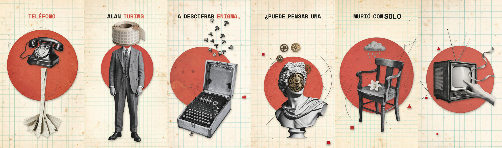

# Collage Studio: reels de collage surrealista animados por Claude en código

Seis skills de Claude que convierten **una imagen de referencia y un tema** en un vídeo vertical terminado:
- Claude escribe el guion y ElevenLabs v4 lo locuta con emociones (con tu voz clonada si quieres).
- Se generan las escenas y se separan en capas.
- Cada fotograma se dibuja en código: las piezas caen y aparecen a dos fotogramas, el papel rasgado cambia de escena y los subtítulos siguen la voz palabra a palabra.

**Sin modelos de vídeo con IA.**

<p align="center"></p>
<p align="center"><sub><b>Alan Turing en 30 segundos</b>, hecho de principio a fin con estas skills: narración con la voz clonada del autor (ElevenLabs v4 con emociones), 6 escenas generadas y separadas en Atlas Cloud y cada fotograma dibujado en código. Coste total ≈ $1,72.<br><a href="docs/demo.mp4">MP4 con sonido</a> · <a href="examples/alan-turing">Cómo se hizo</a> · <a href="README.md">English</a></sub></p>
<p align="center"></p>

## El flujo

```
 referencia ──► 1 collage-style ──► style/      paleta, tipografía, ritmo, prompt de imagen
 tema ────────► 2 collage-script ─► script/     gancho + una frase por escena con su giro visual
                3 collage-voice ──► voice/      voz ElevenLabs v4 con emociones + tiempos
                4 collage-scenes ─► scenes/     escenas generadas → fondo + una capa por pieza
                5 collage-animate ► final.mp4   animado en código, sincronizado, sonidos de papel
      ★ collage-reel ejecuta 1→5 y te pide permiso antes de cada gasto
```

| Skill | Qué hace | Coste |
|---|---|---|
| **collage-reel** | El productor: ejecuta todo, retoma proyectos a medias y pide confirmación antes de gastar | — |
| **collage-style** | Lee 1–3 referencias y escribe la biblia de estilo | Gratis |
| **collage-script** | Gancho, una frase por escena, una imagen imposible y un momento animado por frase, con datos verificados | Gratis |
| **collage-voice** | Voz con ElevenLabs v4 y una emoción por frase, con cualquier voz de tu cuenta (también tu voz clonada), sincronizada por sus pausas: corte exacto por frase y palabras ancladas a las respiraciones. También sincroniza tu propia grabación | Caracteres de tu plan de ElevenLabs |
| **collage-scenes** | Decide qué modelo hace cada escena, las genera (Atlas Cloud o Higgsfield) y las separa en fondo + capas transparentes (Seedream Layer Decomposition, o quitar fondo + recortes) | ≈ $0.25–0.70 por escena en Atlas, o créditos de Higgsfield |
| **collage-animate** | Coreografía de cada pieza, papel rasgado, subtítulos, sonido y render a MP4 | Gratis (en tu máquina) |

Todas comparten una misma [carpeta de proyecto](skills/collage-reel/references/project-format.md), así que puedes usarlas juntas o por separado.

## Instalación

```
/plugin marketplace add annderson8/collage-studio
/plugin install collage-studio@collage-studio
```
O a mano: `cp -r collage-studio/skills/* ~/.claude/skills/`.

Instaladas como plugin, las skills llevan delante el nombre del plugin: `/collage-studio:collage-reel`, `/collage-studio:collage-voice`… Copiadas a mano se llaman sin prefijo (`/collage-reel`).

**Recomendado: Claude Code en una carpeta vacía.** Crea una carpeta, ábrela en VS Code (o en la terminal, o en la pestaña *Code* de la app de escritorio) y ejecuta `/collage-studio:collage-reel` ahí. Todo corre en tu máquina, el proyecto queda en esa carpeta y en la primera ejecución el productor te ofrece crear un `.claude/settings.local.json` que permite las herramientas de Atlas/ElevenLabs y `node`/`ffmpeg`/`curl`, para que no tengas que aprobar cada imagen. Los gastos siguen esperando tu confirmación.

**Chat de Claude (escritorio o web)**: pega la línea `/plugin marketplace add …` en el chat, o sube los zips de [Releases](../../releases) en *Settings → Capabilities → Skills*. Funciona, pero el código corre en un entorno en la nube con la red cerrada y te pedirá permitir cada dominio del que descarga (Atlas, ElevenLabs, npm).

**Requisitos**: Node ≥ 18, ffmpeg, Chrome/Edge instalado, el conector **ElevenLabs** (voz v4 con emociones y tu voz clonada) y **Atlas Cloud** o **Higgsfield** (imágenes). Sin ellos puedes grabar tu voz y traer tus propias imágenes.

## Uso

```
/collage-studio:collage-reel
Reel de 30 segundos: un breve resumen de quién fue Alan Turing y qué hizo. Usa mi voz clonada y el estilo de esta imagen.
[adjunta 1–3 referencias]
```
Claude te enseña el estilo y el guion (lo apruebas), luego el precio de la voz y las escenas (lo apruebas), después las escenas generadas (las apruebas) y te entrega `final.mp4` con lo que se gastó.

Los guiones y la voz salen en inglés por defecto; puedes pedir otro idioma en cada vídeo.

En [`examples/alan-turing`](examples/alan-turing) están todos los archivos de texto del reel de demostración: biblia de estilo, guion con fuentes, texto de la voz con sus emociones y tiempos por palabra, los seis prompts de escena y la coreografía final.

## Series: mismo estilo, menos coste
Guarda los reels de una serie juntos en una carpeta (`historiadores/tesla`, `historiadores/ada-lovelace`…). Desde el segundo reel, el productor detecta los proyectos hermanos y te ofrece reutilizar su estilo, idioma y voz. Tras el primer reel también puede crear un **kit de la serie** (`_kit/`), gratis, con sus capas: el círculo grande, las líneas de geometría, las figuras rojas y los recortes de periódico, recortados una sola vez. Las escenas nuevas se generan sin ellos y la animación los vuelve a poner, así que la separación en capas (≈ 75 % de lo que se paga en Atlas) devuelve más o menos la mitad de capas.

Medido en la misma serie (10 escenas, ≈ 46 s cada reel): Hedy Lamarr sin kit, 124 capas y $3,02 en Atlas ($2,23 de separación); Grace Hopper con el kit, 48 capas y $1,76 ($1,04 de separación). Es un 53 % menos en la separación y un 42 % menos en total, con el mismo aspecto.

## Límites
- Claude ve los fotogramas pero no oye el audio: escúchalo antes de publicar.
- El reel de demostración (30 s) costó $1,64 en Atlas Cloud (6 escenas a $0,07 y su separación en capas a $0,16–0,29 cada una) más 458 caracteres de un plan de ElevenLabs. Uno de 40–45 s con 8–10 escenas ronda los $2–4, o su equivalente en créditos de Higgsfield. Cada precio se muestra y se confirma antes. Medido en un reel de 50 s con 10 escenas: ≈ 850 créditos de ElevenLabs por la voz (unos $0,15) y $2,45–2,93 en Atlas Cloud (casi todo, ≈ $2,1–2,2, es la separación en capas).
- Lleva tiempo: 45–60 minutos para un reel de 50 s, la mayor parte generando y separando escenas y revisándolas tú.

## Licencia
[MIT](LICENSE) © 2026 Annderson Rey
